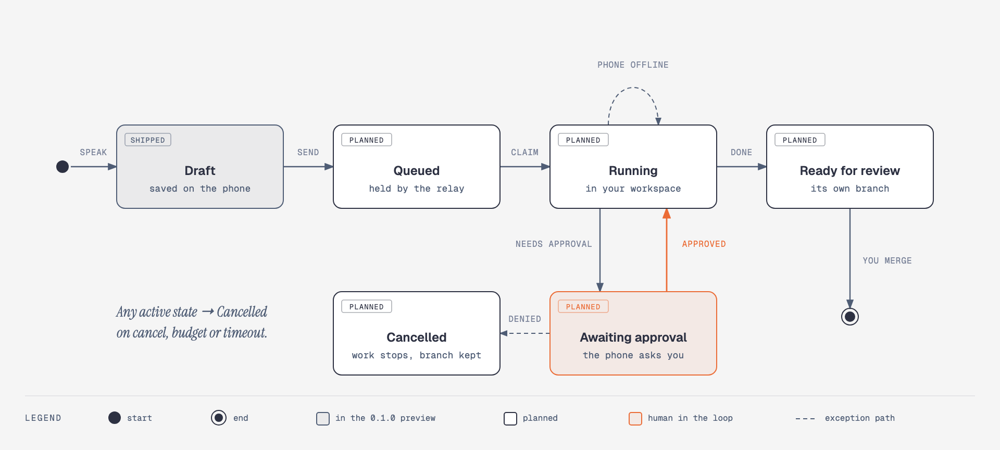

# VoxyGlider

**Direct a coding agent by voice, without handing anyone the keys to your machine.** VoxyGlider is a phone app for directing the coding agent that already runs in your own workspace. The repository, its credentials and the agent runtime never leave that workspace. A small runner inside it holds an outbound-only connection to a relay, so the phone can reach it without the workstation ever accepting an inbound connection. Anything with real consequences — deploying, merging, reading a secret, deleting something — stops at an approval gate that only you can open, from the phone.

This repository is the public design: architecture, trust boundaries, the job lifecycle and the decisions behind them. It contains no source code, and deliberately leaves out the implementation detail that would help someone attack a running system — see [What this repository leaves out](#what-this-repository-leaves-out).

> **Status.** The 0.1.0 preview for iPhone and Android saves task drafts on the device and nothing more. It does not record audio, connect to agents, run code or transmit drafts. Everything below the draft stage describes the design being built, not shipped behaviour. [voxyglider.com](https://voxyglider.com/)

---

## Contents

- [System topology](#system-topology)
- [Trust boundaries](#trust-boundaries)
- [Job lifecycle](#job-lifecycle)
- [Which agent, whose subscription](#which-agent-whose-subscription)
- [Design decisions](#design-decisions)
- [What this repository leaves out](#what-this-repository-leaves-out)
- [Repository layout](#repository-layout)

---

## System topology

<p align="center">
  
</p>

<sub>Source: [`docs/diagrams/topology.html`](docs/diagrams/topology.html) · vector: [`topology.svg`](docs/diagrams/topology.svg)</sub>

Three parties, three zones, and the only thing that crosses all of them is intent:

- **The phone** captures what you want in your own words, shows short progress updates, and answers the agent's questions — including the ones that ask for permission. It holds no repository content beyond what an update shows you, and no credential that can act on your code.
- **The relay** authenticates accounts and paired runners, keeps job state so a job survives a dropped connection, and passes messages between the two ends. It is a meeting point, not a workspace: it never holds a copy of your repository.
- **Your workspace** — a Mac, a Windows or Linux machine, or a remote VM you control — is where the work happens. The VoxyGlider Runner is installed there once and paired with the app. It starts or continues the coding agent's session and is the only component that touches the repository.

The runner dials out; nothing dials in. That one property is what lets VoxyGlider work from a café or a bike ride without a port forward, a tunnel, or a workstation reachable from the internet.

---

## Trust boundaries

| Boundary | What crosses it | What never does |
|---|---|---|
| **Phone → relay** | Task text, your answers to the agent's questions, approvals and cancellations | Repository contents, agent credentials, workspace secrets |
| **Relay ⇄ runner** | Jobs to run, progress events, approval requests and their answers — over a session the runner opened | An inbound connection to the workspace; any shell or file access initiated from outside |
| **Runner → agent** | The task and its context, inside the workspace | Anything that leaves the workspace without passing back through the runner |
| **Agent → privileged action** | Only an action you approved on the phone, for that action | Deploys, merges, secret reads or destructive commands on the agent's own authority |

Every account and every paired runner has its own identity, and access between them is short-lived and revocable. The agent's changes land on an isolated branch or worktree, so the work it does without asking stays somewhere you can review or throw away.

---

## Job lifecycle

<p align="center">
  
</p>

<sub>Source: [`docs/diagrams/lifecycle.html`](docs/diagrams/lifecycle.html) · vector: [`lifecycle.svg`](docs/diagrams/lifecycle.svg)</sub>

A job belongs to the workspace, not to the phone. Losing signal mid-task changes nothing about what is running; when the phone reconnects it picks up the latest state rather than replaying everything it missed.

**Awaiting approval** is the state the design is organised around. A job enters it whenever the agent needs authority beyond editing its own branch, and leaves it only when you answer. Approving resumes the job; denying ends it with the branch intact, so nothing is lost and nothing irreversible happened. Cancellation, a budget limit or a timeout can end any active job the same way.

**Ready for review** is deliberately not "done". The design stops at a branch and a short summary. Reviewing and merging the change stays a decision you make at the desk.

---

## Which agent, whose subscription

VoxyGlider is a control surface, not a model provider. Two modes are planned:

1. **Local agent mode** — the main path. You sign in to Codex on your own workstation with your ChatGPT account, and the work counts against your own plan. VoxyGlider adds voice, reachability, progress and approvals. It never sees or stores the agent's sign-in.
2. **API mode** — optional. A server-side agent runs against an OpenAI API key, billed separately at API pricing. The key lives in a server-side secret store or in your own runner.

In neither mode does the mobile app carry a shared API key.

---

## Design decisions

Recorded in [`docs/ARCHITECTURE.md`](docs/ARCHITECTURE.md). In brief:

- **The workspace keeps the keys.** The agent runs where the code and credentials already are. VoxyGlider moves intent, not repositories.
- **Outbound only.** The runner opens the connection. A workstation that accepts nothing has nothing to attack from the outside.
- **Drive a supported runtime, never a window.** VoxyGlider talks to the agent through its supported interface. It does not automate a desktop app's UI.
- **Deny by default, approve one action at a time.** An approval covers the action you were shown, not a session or a category.
- **Jobs outlive connections.** The phone is a way to steer the work, not a dependency the work runs on.
- **Two native apps.** A voice-first app depends on audio sessions, background behaviour and lock-screen use, and those are platform-specific — so it is SwiftUI on iOS and Jetpack Compose on Android, not a cross-platform UI.
- **Public design, private implementation.** The design has to hold up with everyone able to read it. The operational detail stays private because it only helps an attacker aim.

---

## What this repository leaves out

This is a design document, not a specification an attacker can build tooling against. Kept in the private implementation repository and out of here:

- source code, build configuration and release signing;
- wire formats, message schemas and API routes between the app, relay and runner;
- how pairing, authentication and session tokens are implemented — lifetimes, storage, rotation and revocation mechanics;
- relay hosting, cloud accounts, regions, resource names and any other infrastructure detail;
- rate limits, budget thresholds and abuse-detection rules.

The security properties described above are claims the implementation is held to. Publishing them is deliberate: if the design depended on these details staying secret, it would be the design that needed fixing.

To report a security issue, see [`SECURITY.md`](SECURITY.md).

---

## Repository layout

```
voxyglider-docs/
├── README.md                 This overview
├── SECURITY.md               How to report a vulnerability
└── docs/
    ├── ARCHITECTURE.md       Decision records
    ├── brand/                The VoxyGlider mark
    └── diagrams/             Editable HTML source, SVG and PNG per diagram
```

The private implementation repository includes this one as a submodule, so the design it builds against is always this design.

## Copyright

Copyright © 2026 Byte Visions. All rights reserved.
