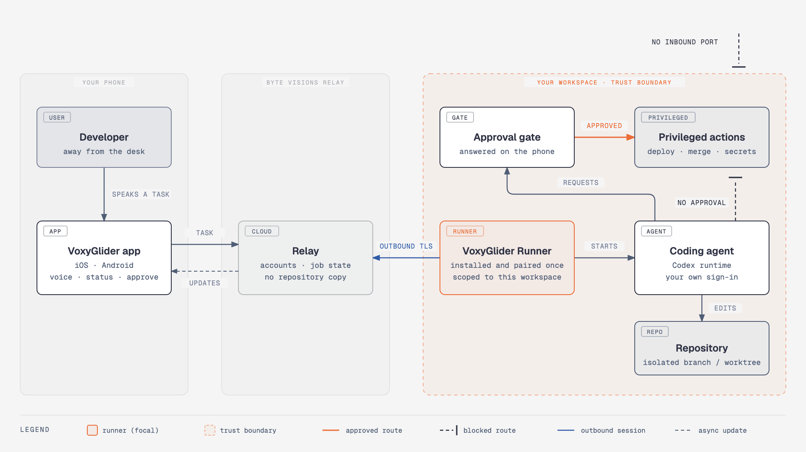

# Architecture decision records

Short, dated notes on the choices that are expensive to reverse.

## Overview — a control surface, not a workspace

Every ADR below rests on one premise: VoxyGlider should be able to direct real work on a real repository without becoming a place where that repository, or the authority to change it, lives.

  

The phone carries intent. The relay carries messages and job state. The workspace carries everything that matters. Each ADR either keeps that split intact or says what it costs.

## ADR-001 — The agent runs in the user's workspace (2026-09)

The obvious alternative is to clone the user's repository into a hosted sandbox and run the agent there. That would make VoxyGlider custodian of every customer's source code and of the credentials needed to build, test and push it. A breach of the service would then be a breach of every repository connected to it.

Running the agent where the code already lives keeps that blast radius at one workspace. It also means the agent sees the real toolchain, the real test suite and the real environment, rather than a hosted approximation of them.

**Cost:** the user installs and pairs a runner, and the workspace must be on for work to progress. A workspace can be a remote VM, so the second cost is a choice rather than a constraint.

## ADR-002 — The runner connects outbound; the workspace accepts nothing (2026-09)

Reaching a workstation from a phone usually means a port forward, a tunnel or a VPN. Each of those makes the workstation an internet-facing service, which is exactly what a developer machine full of credentials should not be.

So the runner opens the connection and keeps it open, and the relay passes messages along it. The workstation needs no listening port, no firewall change and no public address.

**Cost:** the relay becomes a dependency for reachability. It is designed to fail closed: if the relay is unavailable, jobs pause where they are rather than finding another way in.

## ADR-003 — Drive a supported agent runtime, never a desktop window (2026-09)

Automating a chat window — reading its pixels or simulating keystrokes — would work with any agent on day one. It would also break with every UI update, could not tell an approval prompt from ordinary output reliably, and would act with the full authority of a logged-in desktop session.

The runner talks to the agent through the runtime's supported interface, starting with Codex. That gives structured progress, a real point to intercept requests for authority, and authentication that stays with the user's own installation.

**Cost:** each agent runtime is an integration, not a free ride.

## ADR-004 — Deny by default; approve one action at a time (2026-09)

Coding agents are useful because they act. The design separates acting on the agent's own branch, which needs no permission, from acting on anything shared or irreversible, which always does. Deploying, merging, reading secrets and destructive commands all stop at the approval gate.

An approval names the specific action the phone showed you. It is not a session-long grant, and not a blanket "allow deploys". A request the user has not answered is treated as denied.

**Cost:** the agent asks more often than a fully trusted one would. On a phone, a short yes/no beats discovering an unwanted deploy afterwards.

## ADR-005 — Jobs are durable; the phone is optional to execution (2026-09)

A voice-first app is used on the move, and phones on the move lose signal. If a job depended on the phone staying connected, the main use case would also be its main failure mode.

Jobs therefore live in the workspace, with resumable state at the relay. A dropped phone loses nothing; it reconnects to the current state. A job waiting for approval simply waits — until the user answers or the job's timeout ends it.

## ADR-006 — No shared model key on the device (2026-09)

Anything shipped in a mobile app binary can be extracted. A shared provider API key in the app would be everyone's key within days.

In local agent mode the agent authenticates as the user, on the user's machine, with the user's own plan. In API mode the key sits in a server-side secret store or in the user's own runner. The app holds nothing that spends money or reaches a model directly.

## ADR-007 — Two native apps, not a cross-platform UI (2026-09)

The product depends on exactly the things cross-platform toolkits abstract: audio session handling, background execution, lock-screen and headset behaviour, and platform dictation. SwiftUI on iOS and Jetpack Compose on Android give direct control of each, with the same rationale and conventions as [Scribatic](https://github.com/niroshpg/scribatic).

**Cost:** two UIs to keep in step. The behaviour that has to match is small and specified here; how it looks may differ by platform.

## ADR-008 — Public design, private implementation (2026-10)

The trust model above is meant to hold with the design fully public, so it is published. What is not published — wire formats, endpoints, how pairing and session tokens work, infrastructure, limits and abuse detection — is kept private. None of it is a secret the security depends on; publishing it would only give an attacker a map before the implementation has been hardened and reviewed.

The implementation repository consumes this one as a submodule. A change to the design is made here, in the open, first.
